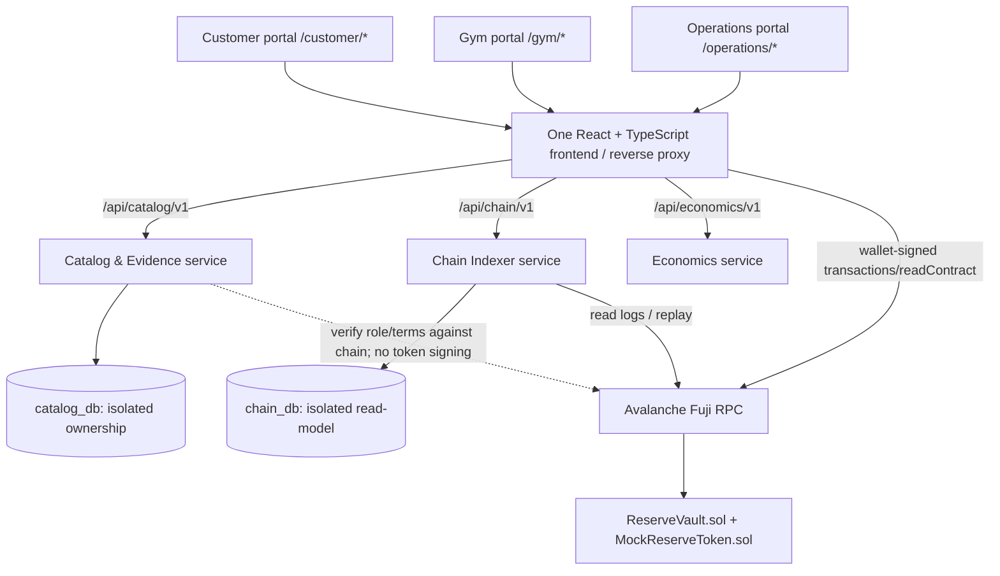

# OPENRESERVE — MICROSERVICES ARCHITECTURE LOCK

**Spec ID:** `OR-UH26-MSA-001`  
**Revision:** `1.0 — 16/11/2026`  
**Change request:** `CR-ARCH-001` — explicitly requested by project owner  
**Active authority:** `OPENRESERVE_EXECUTION_LOCK_16-20_NOV_2026.md` rev 1.2. UX annex rev 1.1.  
**Submission deadline:** 20/11/2026, before 20:00 ICT.  
**Status:** Design decisions only. No deployment, service, code, CI or benchmark is yet verified by these files.

## 0. Architecture decision: microservices where they make sense

**Chosen:** microservices for **three backend capabilities**, in a single monorepo and deployable independently via separate processes/containers, plus one shared React frontend with three first-class portals; financial settlement stays on **Avalanche Fuji smart contracts**. This is a change from the prior explicitly backend-free prototype plan. It **adds operational risk**; microservices do not guarantee performance or agility without correct boundaries and tests.

**Not chosen:** three separate frontends/microfrontends, service-per-table/CRUD, Kafka, Kubernetes, service mesh, microservices holding token keys, multiple contract types, custom Avalanche L1, mainnet/live VND custody, distributed ACID transactions or an “AI fraud oracle”.

**Why three services, not 10:** these are separate business capabilities, data ownership and scaling patterns; a fourth service would increase coordination costs without a validated need in the remaining four development days. Service split is frozen through submission unless owner approves a CR.



*This diagram is a target architecture, not an as-built claim.*

## 1. Service boundaries and ownership

| Deployable | Single responsibility | Allowed writes | Cannot do | Critical when down? |
|---|---|---|---|---|
| `apps/web` | Render all 3 role-specific user journeys and wallet actions | user-signed Fuji transactions, client state only | authorize a transaction merely by URL; invent chain values | UI unavailable, but finalized claims must be available through direct contract tool |
| `catalog-evidence-service` | Catalog descriptions, immutable terms versions, evidence presentation and (only if secure) wallet-signed evidence uploads | own `catalog_db` | approve payouts, edit Vault balances, decide refund rights | No: existing chain agreements survive; show hashes/direct data |
| `chain-indexer-service` | Event projection, agreement history, search and sync status | own `chain_db`, checkpoints | make payments, act as authority for money | No: direct on-chain reads must still work for known agreements |
| `economics-service` | A/B/C/D cashflow and margin calculations | none; stateless | claim profit is verified; sign chain transactions | No: other portals stay functional; Business Lab shows unavailable/fallback clearly |
| `ReserveVault.sol` | Trust-minimized settlement, roles, claim/finalization/payout/refund | contract state on Fuji | know gym physical availability autonomously | Yes, critical; do not bypass |

**Data source precedence for a financial question:** (1) contract state on confirmed Fuji; (2) confirmed receipt/events; (3) indexer projection (labeled by last synced block). Metadata belongs to Catalog/Evidence, but legal rights and withdrawable amounts never belong to an HTTP API.

## 2. API contract freeze — v1

Use **Node.js + TypeScript + Fastify**, request/response schema with Zod or JSON Schema and stable `/v1` version. No GraphQL, gRPC or second API framework for this sprint.

| Service | Endpoint | Result / security |
|---|---|---|
| Catalog | `GET /health`, `GET /ready` | process health and dependency readiness, 200/503 |
| Catalog | `GET /v1/packages` | exactly two **demo** packages including `type`, `termsVersion`, `termsHash`, example label, no fake merchant partner |
| Catalog | `GET /v1/agreements/:id/evidence` | referenced `claimId`, evidenceHash, source `DEMO_FIXTURE` or `SIGNED_UPLOAD`, external link only when present |
| Catalog | `POST /v1/evidence` | only if signed-request auth test passes; verify signature, nonce, expiry, chainId, agreement role on chain and hash; otherwise disabled 501/503 with explanation |
| Indexer | `GET /health`, `GET /ready` | health/readiness incl. RPC & DB status; readiness=degraded if unable to sync |
| Indexer | `GET /v1/agreements/:id` | indexed agreement read projection incl. `chainId`, `contractAddress`, `lastIndexedBlock`, `isStale` |
| Indexer | `GET /v1/agreements/:id/events` | chronological on-chain receipts, hashes, log index; pagination; never invented rows |
| Indexer | `GET /v1/sync` | deployment block, latest indexed, chain tip, lag, last error and replay state |
| Economics | `GET /health`, `GET /ready` | process readiness, 200/503 |
| Economics | `POST /v1/scenarios/compare` | input price, variable gym cost, cost of funds/term, CAC, platform fees, incremental new customer count, refund assumptions; outputs A/B/C/D with gym incremental contribution, cash gap, platform unit margin; labels all as illustrative |

**Sample economics output must include both sides of the business.** An example where referral rate 4% of 1,500,000 VND yields 60,000 VND, while platform CAC=70,000 and variable cost=20,000, must show **−30,000 VND/platform customer before fixed costs**. Values are [MINH HỌA] not market benchmarks.

**API ownership:** each service has `src/server.ts`, `src/routes/`, `src/domain/`, `test/`, `Dockerfile`, `package.json`. No direct import from another service's internal source. Shared safe types may come from `packages/api-contracts`, ABI from `packages/contracts-sdk`.

## 3. Data isolation (genuine separation)

**Recommended minimal setup:** one PostgreSQL server container to save time/cost, **two databases and two database users** with distinct grants. Microsoft architecture guidance notes a shared physical database server can be used if schemas/data and write ownership remain separated. No service has SQL privileges on another service's database.

- `catalog_db` owned by `catalog_user`: `packages`, `terms_versions`, `evidence_records`, `request_nonces` (when signed uploads enabled). Store evidence source and immutable digest; demo fixture seeded and labeled.
- `chain_db` owned by `chain_user`: `chain_events` with unique `(chain_id,tx_hash,log_index)`, `agreement_projection`, `sync_checkpoint`. Database is **derived**, and can be reconstructed from chain events/deployment block.
- `economics-service`: no database; pure calculation; request payloads should not include real identifiable member records.
- `Vault`: financial state; not a PostgreSQL table, not equal to available refunds. Do not create `wallet_balance` table that purports to be authoritative.

**Minimum indexes:** agreement ID, buyer/merchant addresses where events contain them, block number/transaction uniqueness, updatedAt for catalog. Do not overbuild multi-tenant row-level policies for a demo with mock entities.

## 4. Signing and permissions

Frontend `wagmi/viem` sends token approval/deposit, PT/time claim, finalize, withdraw, dispute and refund **to the contract with the user's own wallet**. Services NEVER receive private keys, seed phrases, signing privileges or “hot admin” custody privileges.

For any off-chain write (`POST /evidence`): wallet signs a message bound to **origin/domain, action, agreement ID, payload hash, nonce, expiry and chainId=43113**. Server verifies signer with `viem`, checks nonce freshness and that signer has the relevant role on Vault. Do not trust a `role` field from browser. If this cannot be tested safely by the deadline, disable write and retain a read-only evidence service with prepared, transparently labeled fixtures. **Never open unauthenticated writes in Plan B.**

The Operations portal may render evidence/dispute metadata for a mock resolver address; it cannot gain settlement privileges via the API, only via contract-gated wallet signatures. Cross-origin settings must restrict allowed origins; rate limit writes and validate request bodies.

## 5. Financial semantics remain immutable

- `PER_SESSION`: signed/authorized completion of an actual demo session; unique session key; buyer confirms or bounded resolver decides; gym can withdraw only the finalized amount.
- `TIME_ACCESS`: eligible **past elapsed interval** of maintained access; claims have `[from,to)` time ranges, no overlap; challenge window then finalize under disclosed rules; **check-in has zero effect on earned money**.
- `funds_in_vault ≠ currently_refundable_amount` in general. Refund amount arises from valid mutual/resolver decision, never simply `deposit − withdrawn`.
- Full Reserve for testnet; fee collection from package price on-chain = 0; A/B/C/D as research-only simulator. C is **not** permission to release advance funds in Vault.
- Core invariants I1–I10 from Execution Lock must pass, plus no service can mutate chain accounting. Indexer replay cannot create a new on-chain claim.

**Agreement ID creation:** authoritative result is on-chain transaction receipt/event. Catalog row alone cannot create an active agreement. Three portals use same chainId, address, ID and termsHash.

## 6. Sync, consistency and failure modes

Indexing plan: watch or poll logs since the known Vault deployment block; checkpoint after confirmed events; unique idempotency key `(chainId,txHash,logIndex)`; on restart resume from an overlap/lookback window and dedupe; support explicit replay from a block for test/debug. Verify events from contract addresses only. A small configurable confirmation depth may be used; show pending/unconfirmed as distinct from finalized. Do not claim an exact Fuji finality threshold not verified.

UI: on confirmed transaction receipt, refresh direct on-chain state immediately; display indexed history when available; compare agreement IDs and balances, mark indexer lag. Never hide stale data behind a fake smooth animation. `readContract` on known agreement remains a fallback when indexer service is down.

**Required kill tests** (not production HA claims):

1. Stop economics service → checkout, gym payouts and Operations chain ledger still work; Business Lab explicitly unavailable or uses validated, labeled static comparison.
2. Stop catalog service → existing on-chain agreement can still be opened via deep link and paid/withdrawn/refunded where already eligible; catalog metadata shows unavailable, no invented package details.
3. Stop chain indexer → contract balances still read directly; event search displays degraded and sync error; no wrong balances.
4. Restart indexer and replay events → identical event count, no duplicate `logIndex` rows and correct last sync.
5. Restart a single service without rebuilding/restarting others, demonstrating independent lifecycle.
6. Simulate RPC outage → pending/unknown on-chain reads displayed as **unavailable**, never successful/final; no unverified payment claims.

These tests are essential to support **the architecture claim**; existence of three folders is not enough.

## 7. Repo structure and startup

```text
openreserve/
  OPENRESERVE_EXECUTION_LOCK_16-20_NOV_2026.md
  OPENRESERVE_THREE_PORTAL_UX_SPEC_2026-11-16.md
  OPENRESERVE_MICROSERVICES_ARCHITECTURE_2026-11-16.md
  apps/
    web/                          # one frontend, /customer /gym /operations
  services/
    catalog-evidence/             # independently started REST API, catalog_db
    chain-indexer/               # independently started HTTP API+poller, chain_db
    economics/                   # stateless computation REST API
  packages/
    api-contracts/               # Zod/schema DTOs, stable public contracts
    contracts-sdk/               # ABI, addresses, read/write helpers
  contracts/
    src/ReserveVault.sol
    src/mocks/MockReserveToken.sol
    test/
  infra/
    postgres-init/               # 2 databases + least-privilege users
    reverse-proxy/               # route /api/catalog, /api/chain, /api/economics
  compose.yaml
  .env.example
  docs/
    product-and-terms.md
    contract-interface.md
    service-contracts.md
  research/
  proofs/
    manifest.json
    service-failure-tests.md
    scenarios.md
  .github/workflows/
  README.md
```

- `npm workspaces`: install/test/build each workspace; Node LTS compatible with selected packages, pin `package-lock.json` and versions after verified build.
- `docker compose up --build`: one reproducible local command starts 3 services, frontend, two DBs within one PostgreSQL container, proxy as needed. **Healthchecks** for Postgres and services; downstream `depends_on` only when actually necessary; `restart` policy for transient crashes.
- `docker compose up -d --no-deps --build economics` (after images and environment configured) demonstrates selective service restart. It does not prove high availability or auto-scaling.
- CI: Foundry tests, workspace tests/build/types, API schema contract tests, Docker Compose config validation; optional smoke if runner supports Docker.
- Deployment to public URL: use one small Compose host/reverse proxy if infrastructure ready. Document TLS/host caveat; do not claim production resilience. Backend secrets via environment and protected deployment store, not Git.

## 8. Day-by-day execution gates (subordinate to Execution Lock)

| Day | Backend architecture milestone | Evidence gate |
|---|---|---|
| **16 Nov** | Workspaces, 3 independent `/health` services, 2 DB ownership, `docs/service-contracts.md`, Compose config | 3 processes separately reachable; 3 UX high-fidelity directions approved; Vault deposit test |
| **17 Nov** | Catalog GET & evidence fixtures, Economics calculations, API tests | Both services pass schema/unit tests; smart contract I1–I10 local; Customer UI flow |
| **18 Nov** | Indexer real Fuji events, replay, Compose/route full integration | 4 on-chain TX groups; indexer agreement ID matches Vault; services healthy; Gym & Ops portals working |
| **19 Nov** | Service outage/restart tests, three-portal UX, Business Lab, proof manifest | failure log; indexer degrades gracefully; three independent browser profiles; UI polish verified |
| **20 Nov** | Freeze/version all images, run smoke and test; video/slide/submit | public links, real explorer tx, README, code tag and submission before 20:00 ICT |

**Activation of Plan B:** Human must approve by code in Execution Lock. Never silently collapse three services into a single app and call it microservices. If public container deploy is blocked by hosting, 3 services may run independently in local Compose **with explicitly disclosed limited public availability**; continue submission with recorded evidence only if truthful and approved by owner.

## 9. Performance, scaling claims and what not to promise

The design supports **separate scale knobs in principle**: economics HTTP workers can be replicated statelessly; Catalog can scale after DB/caching review; Indexer requires coordinated singleton processing or partitioned ranges to prevent redundant checkpoints; frontend assets can be distributed by CDN. No load, latency, cost or availability metrics are known until benchmarked. **Do not call this 'production scale achieved'.**

Demo proof for independent components is **failure isolation + lifecycle isolation + data ownership**, not “handles a million requests.” Future scaling requires access controls, real ops logging/tracing, backups, rate limits, reorg strategy, distributed indexing leader election, secrets rotation and formal security review.

## 10. Change-control and source evidence

- This annex describes **what must be built**. It does not prove a service was created, a contract deployed, or a test run.
- If any AI suggests another stack, gateway, backend auth provider, database, broker or deployed contract, mark `SCOPE VIOLATION` unless the user approves change request after showing actual blocker.
- Current evidence base for business claims: 21 consumer responses, 3 provider representative responses and 1 A/B/C/D model response (possible overlap; no proof of distinct gym businesses). Economic simulations do not prove profit.
- Legal boundary: Fuji mock token only, not VND custody or live gym payments. Actual payments/custody require separate Vietnamese legal/payment-provider validation.
- Architecture references for rationale: Microsoft Azure Architecture Center *Microservices Architecture Style* and *Data Considerations for Microservices*, Docker Compose docs `service_healthy`, Martin Fowler *Microservices Guide*. Source URLs live in submission references; all material facts must be rechecked before public pitch.
